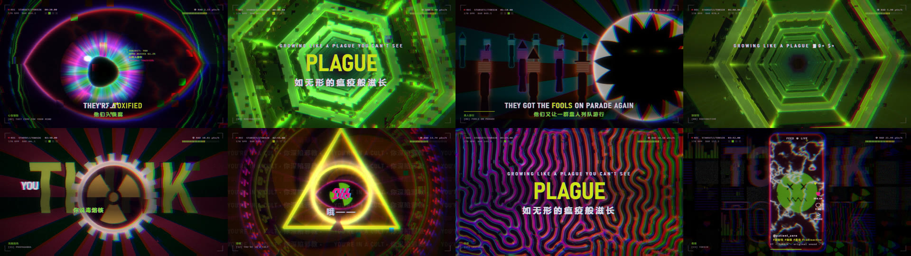

# TOKSIK · 毒音 — a beat-synced acid / cyberpunk / glitch MV

An unofficial fan music video for **STARSET — "TokSik"**. It is rendered in real time by a WebGL2 engine written from scratch and cut to the song's beat grid, which is measured from the audio itself. The lyrics are shown in English and Chinese.

STARSET《TokSik》的非官方同人 MV。画面由一套从零手写的 WebGL2 引擎实时渲染，所有剪辑和动效都对齐到从音频分析出的节拍网格上，歌词以中英双语显示。



> **Copyright / 版权说明**
> The song and its lyrics belong to STARSET and their label, and they are **not** covered by this repository's MIT license. `web/audio/toksik.flac` is bundled only so the demo runs out of the box — replace it with your own legally obtained copy if you fork this. No timed lyrics are shipped: supply your own `web/js/lyrics.js`.
> 歌曲与歌词的版权归 STARSET 及其唱片公司所有，**不适用**本仓库的 MIT 许可证。`web/audio/toksik.flac` 仅为开箱即用而附带，fork 时请替换为你自己合法获得的副本；带时间轴的歌词未随仓库发布，请自行提供 `web/js/lyrics.js`。

## Features / 特点

- **Original audio analysis** (numpy/scipy, no beat-tracking library):
  - onset envelope from log-band spectral flux
  - tempo from a DFT tempogram plus a joint BPM/phase fit: **170.000 BPM**, drift under ±5 ms
  - bar phase chosen by maximum bar-to-bar energy contrast
  - kick, snare and hat strengths measured on every 16th-note grid point
  - 60 fps envelopes, a 32-band spectrum and an oscilloscope frame per video frame
- **Hand-written WebGL2 pipeline**: reaction–diffusion sim → scene → feedback / datamosh → 5-level bloom → post (glitch blocks, VHS tear, chromatic aberration, CRT scanlines, kaleidoscope, tiling, CRT power-off).
- **10 GLSL scenes**, each tied to the lyrics:
  - burning acid sky
  - the eye / "the hills have eyes"
  - Gray–Scott plague that grows the word *EVERYTHING*
  - radioactive hex tunnel
  - the "毒音" feed phone
  - parade of fools into the lion's den
  - globe → volumetric mushroom cloud
  - reactor meltdown
  - propaganda poster
  - cult sigil
- **Beat sync**:
  - kicks drive zoom punch, chroma, bloom and shake; snares drive glitch and tear
  - the tunnel camera surges one rib per beat and crosses a trefoil gate on every downbeat
  - rotations step per beat or per bar
  - lyric cuts snap to beats, and word stamps snap to 16ths
- **Bilingual kinetic typography**: decrypt-in verses, chorus key-word slams with echo answers, stutter shouts, stamped rap words with section graphics (Dunning–Kruger curve, barcode, censor bar, hazard tape).

中文要点：
- 自研音频分析：BPM、节拍相位、小节线、16 分音符鼓点强度
- 手写 WebGL2 多通道渲染管线，10 个 GLSL 场景，每个场景对应一段歌词主题
- 画面动效和剪辑全部对齐节拍
- 中英双语动态字幕

## Requirements / 环境

- Python 3.10+ with `pip install -r requirements.txt`
- Node.js 18+ (no npm packages needed)
- ffmpeg: on `PATH`, via `$FFMPEG`, or from the `imageio-ffmpeg` pip package
- Chrome or Edge, auto-detected, or set `$BROWSER`. Only needed for offline rendering.

## Quick start / 快速开始

```bash
# 1. the song ships at web/audio/toksik.flac / 音频已附带
#    swap in your own legally obtained copy if you fork / fork 时请替换为你自己的副本

# 2. analyse it -> web/data.js / 分析音频
pip install -r requirements.txt
python analysis/analyze.py

# 3. lyrics / 歌词
#    copy web/js/lyrics.example.js to web/js/lyrics.js and fill in the timed lines

# 4. real-time player / 实时播放 -> http://localhost:8765
node render/server.js

# 5. offline render to MP4 (1080p60) / 离线渲染成视频
node render/server.js --render out/TokSik_MV_1080p60.mp4
```

Player keys / 播放器按键：`Space` 播放/暂停 · `←/→` ±5 s · `F` 全屏 · `H` 隐藏字幕层

Render options / 渲染参数：`--w 1920 --h 1080 --fps 60 --start 0 --end 231.39 --crf 19 --preset slow --maxrate 45M`

Review sheet / 审阅缩略图：`node render/server.js --shot "times=10,40,90,150&cols=4" --w 960 --h 540` → `out/review/sheet.png`

## Layout / 目录

```
analysis/analyze.py      audio analysis -> web/data.js
analysis/audio_io.py     ffmpeg decode + STFT + filterbank
render/server.js         static server, offline renderer (headless browser -> ffmpeg), review sheets
web/index.html           player page
web/js/gl.js             tiny WebGL2 helper (programs, float targets, fullscreen pass)
web/js/shaders_*.js      GLSL: shared library, scenes, feedback, bloom, post
web/js/timeline.js       beat grid, envelopes, section map and the per-frame director
web/js/hud.js            Canvas2D typography + HUD overlays
web/js/main.js           render graph and the play / render / sheet modes
```

## License / 许可

MIT — see [LICENSE](LICENSE). The license covers the source code only; it does not cover the song, the lyrics or any STARSET material.

MIT 许可证，见 [LICENSE](LICENSE)。该许可证仅涵盖源代码，不涵盖歌曲、歌词或任何 STARSET 相关素材。
